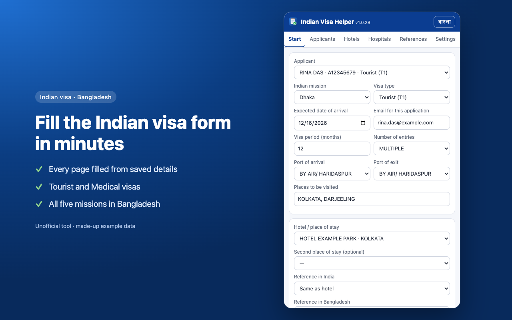
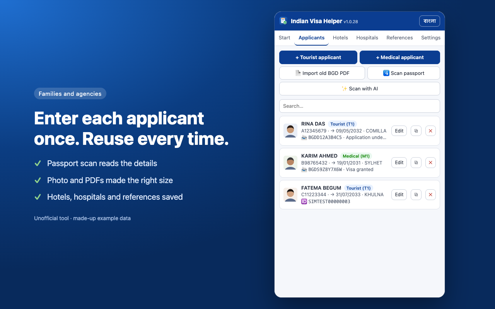
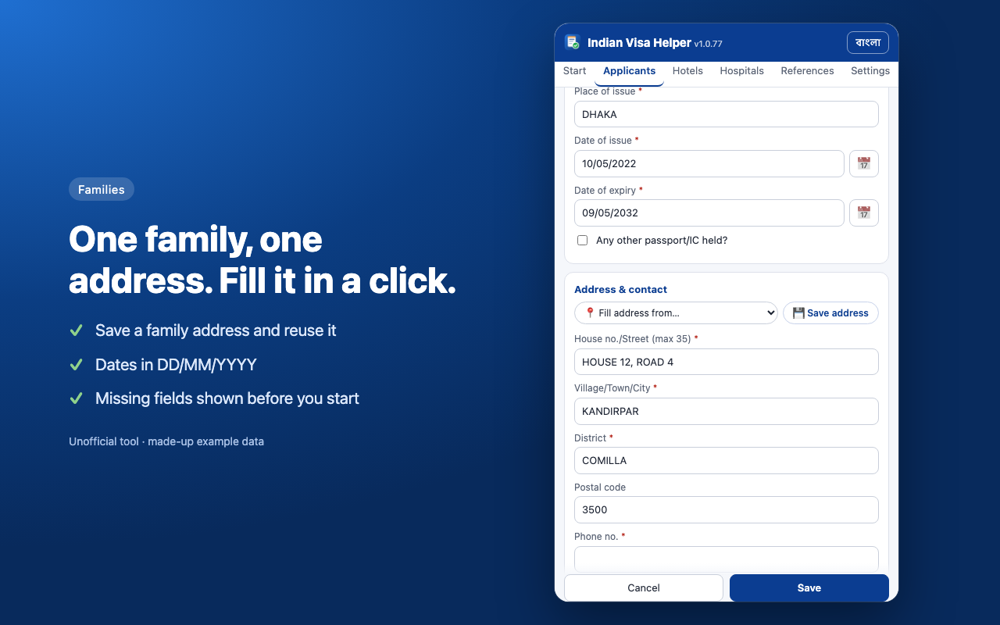

# Indian Visa Form Helper – Bangladesh

A Chrome extension (Manifest V3) that fills the official Indian visa application at
[indianvisa-bangladesh.nic.in](https://indianvisa-bangladesh.nic.in) from saved applicant details — for Tourist and
Medical visas at all five Indian missions in Bangladesh — plus a small helper server for free passport OCR and hotel
search. English and Bangla interface.

[](https://chromewebstore.google.com/detail/janilojppmedlpmlkheleblglanlmfpe)

Free to use · Unofficial: not made by or linked to the Government of India.



| | |
|---|---|
|  |  |

## Install

1. Open the **[Chrome Web Store page](https://chromewebstore.google.com/detail/janilojppmedlpmlkheleblglanlmfpe)** in
   Google Chrome (or Edge, Brave and other Chromium browsers).
2. Click **Add to Chrome**, then **Add extension**.
3. Click the puzzle icon in the toolbar and pin **Indian Visa Form Helper**; click it to open the side panel.
4. To try it at once: Settings → **Try it with example data**.

Updates install by themselves. Everything except the optional AI scan is free.

## What it does

- **Fills every page of the application**: personal and passport details, address, family, visa details, references,
  place of stay, photo and document upload. The applicant only types the captcha and clicks the final
  "Verified and Continue" — those are never automated.
- **Passport scan**: drag in a photo or PDF of the passport. A free server OCR (RapidOCR / PP-OCR on ONNX Runtime) or
  an offline in-browser OCR (Tesseract.js) reads it; fields are parsed from the MRZ, whose check digits verify the
  passport number and dates, and from the printed page and the emergency-contact page (parents, spouse, address,
  phone). Optional AI scan with the user's own key.
- **Pre-flight check** before starting, so a captcha is never spent on an application that would stop half-way.
- **Free hotel search by city** (OpenStreetMap, hotels' own websites, Google Places), with real phone numbers.
- **Families and agencies**: applicant list, saved family addresses, a queue for travelling together, Temporary ID
  and Application ID history, the final application PDF kept with each applicant, visa status check in one click.
- **Documents**: photo cropped to 350×350, documents converted to PDFs the site accepts, Medical visa undertaking.
- **Keeps working when the site changes**: a server-side site check every 12 hours and a published field map.
- **Updates itself** from the Chrome Web Store as soon as nothing is being filled.

## How it is built

```
Chrome extension (MV3)                              Helper server (Node, VPS behind Caddy)
├─ side panel UI ──────── fetch ───────────────────► /api/ocr      → OCR container (Python, RapidOCR)
├─ content script on the visa site                  /api/hotels   → OpenStreetMap list, websites, Google Places
│   └─ page bridge (MAIN world) drives the site's   /api/ai       → invite-only AI relay
│      jQuery handlers                              /api/sync     → end-to-end encrypted agency sync
├─ background service worker (field map, updates)   /api/fieldmap.json, admin dashboard (private network only)
└─ lib/: MRZ + passport parsers, BGD PDF parser, image/PDF tools, pdf.js, Tesseract.js
```

- **Extension**: plain JavaScript, no framework or bundler for app code; ES modules in `extension/lib/`.
  All applicant data stays in the browser (`chrome.storage.local`).
- **Server**: Node.js with no npm dependencies, a Dockerised OCR service, monthly OpenStreetMap refresh.
  Images and searches are processed in memory and never stored. Secrets live only on the server.
- **Testing**: a side-panel harness with a `chrome.*` mock, and simulated copies of the visa site's pages
  (`tools/sim/`) to exercise the content scripts without touching the live site.

## Project layout

```
extension/   the extension (load this folder in chrome://extensions → Load unpacked)
server/      helper server, OCR container, deploy scripts
store/       Web Store listing, privacy policy, screenshots and their generators
tools/       dev scripts, panel harness, site simulators, tests, private-data check
CHANGELOG.md every version and what changed
```

## Development

```bash
npm install && npm run vendor        # pdf.js, Tesseract.js, SDK sources → extension/lib
python3 -m http.server 8765          # then open http://localhost:8765/tools/panel-harness.html
npm run zip                          # build the tester and Web Store packages in dist/
```

A pre-commit hook (`.githooks/pre-commit` → `tools/check-private.mjs`) blocks commits that contain personal data
such as emails, phone, passport or NID numbers, IP addresses or API keys. Enable it after cloning with
`git config core.hooksPath .githooks`. All names and numbers in this repository are made-up examples.

## Author

Designed and built by **Amrita Chandra Das** — Chrome extension, OCR, Node.js server and VPS deployment.

- GitHub: [@amritadasbijoy](https://github.com/amritadasbijoy)
- Chrome Web Store: [Indian Visa Form Helper](https://chromewebstore.google.com/detail/janilojppmedlpmlkheleblglanlmfpe) (publisher: Amrita Chandra Das)

## License

Copyright © 2026 Amrita Chandra Das. All rights reserved. The source is published to show the work; it may not be copied,
modified or redistributed without written permission. See [LICENSE](LICENSE).
